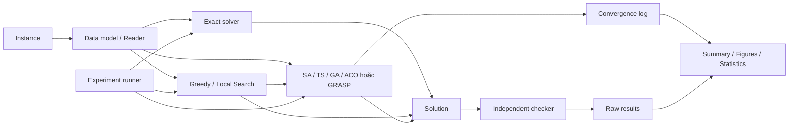

# Nhóm 09 — Đề 10: Đặt camera giám sát giao thông

> Bài toán phủ tập có trọng số (Weighted Set Cover)

README này là sườn triển khai chung của project. Mỗi thành viên cập nhật phần mình phụ trách,
nhưng phải giữ thống nhất định dạng dữ liệu, giao diện chạy, ngân sách và cấu trúc kết quả.

## 1. Thông tin nhóm

| Thành viên | Họ tên — MSSV | Phần code | Phần báo cáo và slide |
|---|---|---|---|
| A  | `Phan Việt Anh` | Bộ đọc, bộ kiểm tra, thuật toán chính xác, SA | Bài toán, NP-khó, thuật toán chính xác, SA, ghép báo cáo |
| B | `Hoàng Duy Khánh` | Tham lam Chvátal, xóa cột thừa, tìm kiếm cục bộ, TS, bộ sinh dữ liệu | Heuristic, tìm kiếm cục bộ, Tabu Search |
| C | `Huỳnh Xuân Huy` | GA và GA lai tìm kiếm cục bộ | Genetic Algorithm và thuật toán lai |
| D | `Nguyễn Thanh Mai` | ACO hoặc GRASP, script thực nghiệm, biểu đồ, kiểm định | Thực nghiệm, phân tích thống kê, kết luận |

## 2. Phát biểu bài toán

Có `m` nút giao cần giám sát và `n` vị trí đặt camera. Vị trí `j` có chi phí `c_j`
và quan sát được tập nút `S_j`. Cần chọn các vị trí có tổng chi phí nhỏ nhất sao cho
mọi nút giao được ít nhất một camera quan sát.

Với biến nhị phân `x_j = 1` nếu chọn vị trí `j`:

```text
minimize    sum(c_j * x_j), j = 1..n
subject to  sum(x_j: i thuộc S_j) >= 1, i = 1..m
            x_j thuộc {0, 1}
```

Trong OR-Library, nút giao là hàng và vị trí camera là cột của ma trận phủ.

## 3. Mục tiêu project

- [ ] Đọc đúng định dạng Set Cover của OR-Library.
- [ ] Kiểm tra độc lập tính hợp lệ và chi phí của nghiệm.
- [ ] Cài thuật toán chính xác cho dữ liệu nhỏ.
- [ ] Cài heuristic xây dựng và hai cấu trúc lân cận.
- [ ] Cài bốn metaheuristic cho nhóm bốn thành viên.
- [ ] Cài ít nhất một thuật toán lai.
- [ ] Chạy thực nghiệm trên dữ liệu chuẩn và dữ liệu tự sinh.
- [ ] Phân tích độ nhạy tham số của từng metaheuristic.
- [ ] Thực hiện kiểm định thống kê Wilcoxon hoặc Friedman.
- [ ] Hoàn thiện báo cáo, slide và demo có thể tái lập.

## 4. Kiến trúc dự kiến



Nguyên tắc kiến trúc:

- Mọi thuật toán dùng chung bộ đọc và mô hình dữ liệu.
- Bộ kiểm tra độc lập với các solver.
- Seed, ngân sách và tham số phải truyền được qua dòng lệnh.
- Mỗi lần chạy tạo nghiệm, log hội tụ và một dòng kết quả thô.
- Script tổng hợp chỉ đọc kết quả, không sửa kết quả thuật toán.

## 5. Cấu trúc thư mục mục tiêu

```text
Nhom09_De10/
├── README.md
├── src/
│   ├── scp_core.py             # mô hình dữ liệu, bộ đọc, hàm dùng chung
│   ├── kiemtra.py              # bộ kiểm tra nghiệm độc lập
│   ├── exact.py                # nhánh cận hoặc quay lui
│   ├── greedy.py               # Chvátal và xóa cột thừa
│   ├── local_search.py         # các lân cận, FI và BI
│   ├── sa.py                   # Simulated Annealing
│   ├── tabu.py                 # Tabu Search
│   ├── ga.py                   # Genetic Algorithm
│   ├── hybrid.py               # GA + Local Search
│   └── aco_or_grasp.py         # ACO hoặc GRASP
├── data/
│   ├── vidu/                   # ví dụ nhỏ trong đề và nghiệm tối ưu
│   ├── chuan/                  # OR-Library hoặc LINKS.txt
│   └── tusinh/                 # dữ liệu tự sinh và chương trình sinh
├── experiments/
│   ├── run_all.py              # chạy toàn bộ thực nghiệm
│   ├── summarize.py            # tổng hợp bảng
│   ├── plot.py                 # sinh biểu đồ
│   └── statistics.py           # kiểm định thống kê
├── results/
│   ├── raw/                    # CSV mỗi lần chạy
│   ├── conv/                   # log hội tụ
│   ├── solutions/              # nghiệm tốt nhất
│   └── figures/                # biểu đồ PNG/PDF
├── report/
│   ├── BaoCao_Nhom09_De10.pdf
│   └── Slide_Nhom09_De10.pdf
└── plan/
    └── ke_hoach_hop_nhom.md
```

Tên module có thể điều chỉnh theo code thực tế. Trách nhiệm giữa các tầng và định dạng
đầu vào/đầu ra phải giữ ổn định.

## 6. Quy ước dữ liệu

### 6.1. Tệp instance

Định dạng OR-Library, đọc theo từ tố:

```text
m n
c_1 c_2 ... c_n
k_1 col_1 col_2 ...
k_2 col_1 col_2 ...
...
k_m col_1 col_2 ...
```

- `m`: số hàng, tương ứng các nút giao.
- `n`: số cột, tương ứng các vị trí camera.
- `c_j`: chi phí chọn cột `j`.
- `k_i`: số cột phủ hàng `i`.
- Chỉ số cột bắt đầu từ `1`.
- Mỗi hàng phải được ít nhất một cột phủ.

### 6.2. Tệp nghiệm

```text
<tong_chi_phi>
<danh_sach_cot_tang_dan>
```

Ví dụ nghiệm tối ưu của instance trong đề:

```text
16
1 2 4
```

### 6.3. Log hội tụ

```text
time_s,iter,evals,best
```

Nhóm phải thống nhất định nghĩa `evals` trước khi dùng số lần đánh giá làm ngân sách
so sánh.

### 6.4. Kết quả thô

Mỗi dòng tương ứng một lần chạy:

```text
instance,n,algorithm,params,seed,run,best_value,time_s,time_to_best_s,evaluations,feasible
```

Quy ước tên tệp:

```text
<instance>_<algorithm>_s<seed>.sol
<instance>_<algorithm>_s<seed>_conv.csv
```

Chỉ dùng chữ không dấu, chữ số, dấu gạch dưới và dấu chấm trong tên tệp.

## 7. Kế hoạch thuật toán

### 7.1. Thuật toán chính xác

- Nhánh cận hoặc quay lui.
- Loại cột bị trội.
- Xử lý hàng chỉ có một cột phủ.
- Chọn hàng chưa phủ có ít lựa chọn để phân nhánh.
- Giải đúng ví dụ đề và dữ liệu tự sinh đến khoảng 30 cột.
- Đo kích thước lớn nhất giải được trong 10 phút.

### 7.2. Heuristic và tìm kiếm cục bộ

- Tham lam Chvátal: chọn cột theo `chi phí / số hàng mới phủ`.
- Xóa cột thừa sau khi tạo nghiệm.
- Lân cận 1: bỏ một cột rồi sửa chữa.
- Lân cận 2: đổi một cột chọn với một cột chưa chọn.
- Cài cả first improvement và best improvement.
- Duy trì số cột đang phủ mỗi hàng để đánh giá delta.

### 7.3. Metaheuristic

| Thuật toán | Người phụ trách | Nội dung cần chốt |
|---|---|---|
| SA | A | Nhiệt độ đầu, lịch làm nguội, số bước mỗi mức nhiệt, lân cận |
| TS | B | Lân cận, tabu tenure, aspiration, tiêu chí dừng |
| GA | C | Mã hóa, khởi tạo, chọn lọc, lai ghép, đột biến, thay thế |
| ACO hoặc GRASP | D | Chọn thuật toán, tham số, cách xây dựng nghiệm |
| GA + Local Search | C | Vị trí gọi local search, lân cận, giới hạn chi phí xử lý |

Với mỗi metaheuristic, báo cáo phải có:

- Nguồn gốc và tài liệu gốc.
- Mã giả tổng quát và mã giả áp dụng cho Set Cover.
- Biểu diễn nghiệm và cách xử lý ràng buộc.
- Tiêu chí dừng.
- Ý nghĩa và cách chọn từng tham số.
- Phân tích độ phức tạp mỗi vòng lặp.

## 8. Giao diện chạy thống nhất

Mỗi solver nên hỗ trợ giao diện tương đương:

```text
python <solver.py> <input_file> <algorithm> <output_sol> [seed] [budget] [conv_csv] [algorithm_params...]
```

Ví dụ khung:

```sh
python src/<solver.py> data/vidu/vidu.txt <ALGORITHM> output.sol 42 10 conv.csv
python src/kiemtra.py data/vidu/vidu.txt output.sol
```

Mỗi module phải bổ sung vào README chính thức:

- Lệnh chạy cụ thể.
- Danh sách tham số và giá trị mặc định.
- Seed đã dùng.
- Cách diễn giải output và log.

## 9. Kế hoạch dữ liệu

Tối thiểu 10 instance thuộc ít nhất 3 mức kích thước, gồm dữ liệu chuẩn và tự sinh.

| Nhóm dữ liệu | Số lượng dự kiến | Mục đích |
|---|---:|---|
| Nhỏ | `[Điền]` | Đối chiếu với thuật toán chính xác |
| Vừa | `[Điền]` | Tinh chỉnh và so sánh thuật toán |
| Lớn | `[Điền]` | Đánh giá khả năng mở rộng |

Dữ liệu chuẩn gợi ý:

- `scp4x`, `scp5x`, `scp6x`.
- `scpa`–`scpd`.
- `scpnre`–`scpnrh`.
- `scp41`: 200 hàng, 1.000 cột, tối ưu công bố `429`.

Với dữ liệu tự sinh, phải lưu:

- Kích thước `m`, `n`.
- Khoảng chi phí.
- Mật độ phủ hoặc cách sinh quan hệ phủ.
- Seed sinh dữ liệu.
- Giá trị tối ưu hoặc cách xác định giá trị tham chiếu.

## 10. Thiết kế thực nghiệm

### 10.1. Quy tắc chung

- Chạy mỗi metaheuristic ít nhất 10 lần độc lập; khuyến khích 30 lần.
- Dùng cùng máy, ngôn ngữ và ngân sách cho các thuật toán được so sánh.
- Dùng danh sách seed cố định, dự kiến `1..10`.
- Tách tập tinh chỉnh tham số khỏi tập đánh giá cuối.
- Kiểm tra mọi nghiệm bằng bộ kiểm tra độc lập.
- Không gọi một giá trị là tối ưu nếu chưa có chứng nhận hoặc nguồn.

Ngân sách gợi ý của đề:

- 30 giây cho `scp4x`–`scp6x`.
- 120 giây cho các bộ lớn.

Ngân sách chính thức của nhóm: `[Thời gian hoặc số lần đánh giá — điền sau khi thống nhất]`.

### 10.2. Chỉ số đánh giá

- Giá trị tốt nhất.
- Giá trị trung bình.
- Độ lệch chuẩn.
- Thời gian trung bình.
- Thời gian tìm thấy nghiệm tốt nhất.
- Tỉ lệ nghiệm hợp lệ.
- Tỉ lệ đạt tối ưu trên dữ liệu nhỏ.
- Gap so với tối ưu hoặc BKS.

Với `f* > 0`:

```text
gap(%) = abs(f - f*) / f* * 100
```

### 10.3. Biểu đồ và kiểm định

- Đường hội tụ theo thời gian hoặc số lần đánh giá.
- Trung vị và khoảng tứ phân vị qua nhiều lần chạy.
- Boxplot giá trị cuối.
- Phân tích độ nhạy tham số cho từng metaheuristic.
- Wilcoxon cho so sánh cặp hoặc Friedman cho nhiều thuật toán.
- Ghi giả thuyết, mức ý nghĩa và cách ghép cặp dữ liệu.

### 10.4. Cấu hình cần ghi lại

```text
CPU:                [Điền]
RAM:                [Điền]
Hệ điều hành:       [Điền]
Python:             [Điền]
Phiên bản mã nguồn: [Commit hash]
Ngân sách:          [Điền]
Seed:               [Điền]
```

## 11. Kịch bản tái lập

Các lệnh dưới đây là khung. Cập nhật tên script khi hoàn thiện:

```sh
# Kiểm tra ví dụ nhỏ
python src/<exact_solver.py> data/vidu/vidu.txt EXACT results/solutions/vidu_EXACT.sol 42 10
python src/kiemtra.py data/vidu/vidu.txt results/solutions/vidu_EXACT.sol

# Chạy toàn bộ thực nghiệm
python experiments/run_all.py

# Tổng hợp và sinh biểu đồ
python experiments/summarize.py
python experiments/plot.py
python experiments/statistics.py
```

README bản nộp phải ghi rõ thời gian ước tính và lệnh tái lập từng bảng, biểu đồ trong
báo cáo.

## 12. Sườn báo cáo

| Phần | Nội dung | Số trang gợi ý |
|---|---|---:|
| (a) Phát biểu bài toán | Bối cảnh, mô hình toán học, ví dụ nhỏ | 2–4 |
| (b) Độ phức tạp | Phiên bản quyết định, NP-khó, không gian tìm kiếm | 2–3 |
| (c) Thuật toán chính xác | Mã giả, cắt nhánh, độ phức tạp, giới hạn kích thước | 2–4 |
| (d) Heuristic và local search | Tham lam, hai lân cận, FI/BI, delta evaluation | 3–5 |
| (e) Metaheuristic | Nguyên lý, toán tử, tham số, xử lý ràng buộc | 5–10 |
| (f) Thực nghiệm | Môi trường, dữ liệu, bảng, biểu đồ, kiểm định, thảo luận | 5–10 |
| (g) Kết luận và phụ lục | Kết luận, hạn chế, tài liệu tham khảo, phân công | 1–4 |

Yêu cầu chung:

- Báo cáo PDF dài 20–40 trang, chưa kể phụ lục.
- Có trang bìa, mục lục, số trang và tài liệu tham khảo.
- Ghi nguồn cho ý tưởng, mã tham khảo và công cụ AI đã dùng.
- Bảng phân công nêu rõ phần việc và tỉ lệ đóng góp.

## 13. Sườn slide và demo

Thời lượng trình bày dự kiến 15–20 phút, sau đó vấn đáp.

1. Bối cảnh và mô hình Set Cover.
2. Tính NP-khó và lý do dùng metaheuristic.
3. Thuật toán chính xác, heuristic và local search.
4. Bốn metaheuristic và thuật toán lai.
5. Thiết kế thực nghiệm.
6. Kết quả, biểu đồ và kiểm định.
7. Kết luận và hạn chế.
8. Demo.

Demo phải tái lập được:

- Bộ kiểm tra trên ví dụ nhỏ.
- Thuật toán chính xác cho giá trị `16`.
- Một metaheuristic trên instance chuẩn với seed cho trước.
- Một dòng kết quả trong báo cáo.

## 14. Mốc thực hiện

| Giai đoạn | Sản phẩm | Người phụ trách | Trạng thái |
|---|---|---|---|
| Hạ tầng | Bộ đọc, bộ kiểm tra, ví dụ nhỏ | A | `[ ]` |
| Mốc đối chiếu | Thuật toán chính xác, giới hạn 10 phút | A | `[ ]` |
| Heuristic | Chvátal, xóa thừa, hai lân cận | B | `[ ]` |
| Metaheuristic | SA, TS, GA, ACO hoặc GRASP | A–D | `[ ]` |
| Thuật toán lai | GA + Local Search | C | `[ ]` |
| Dữ liệu | Chuẩn, tự sinh, danh mục và BKS | B và nhóm | `[ ]` |
| Thực nghiệm | Raw CSV, nghiệm, log hội tụ | D và nhóm | `[ ]` |
| Phân tích | Bảng, biểu đồ, độ nhạy, kiểm định | D và nhóm | `[ ]` |
| Hồ sơ nộp | README, báo cáo, slide, demo | Cả nhóm | `[ ]` |

## 15. Tài liệu tham khảo khởi đầu

- R. M. Karp, “Reducibility Among Combinatorial Problems,” 1972.
- V. Chvátal, “A Greedy Heuristic for the Set-Covering Problem,” 1979.
- J. E. Beasley và P. C. Chu, “A Genetic Algorithm for the Set Covering Problem,” 1996.
- J. H. Holland, *Adaptation in Natural and Artificial Systems*, 1975.
- P. Moscato, “Towards Memetic Algorithms,” 1989.
- OR-Library Set Covering datasets và nguồn tối ưu/BKS tương ứng.

Danh mục cuối phải dùng một chuẩn trích dẫn thống nhất và ghi đúng nguồn dữ liệu đã dùng.
